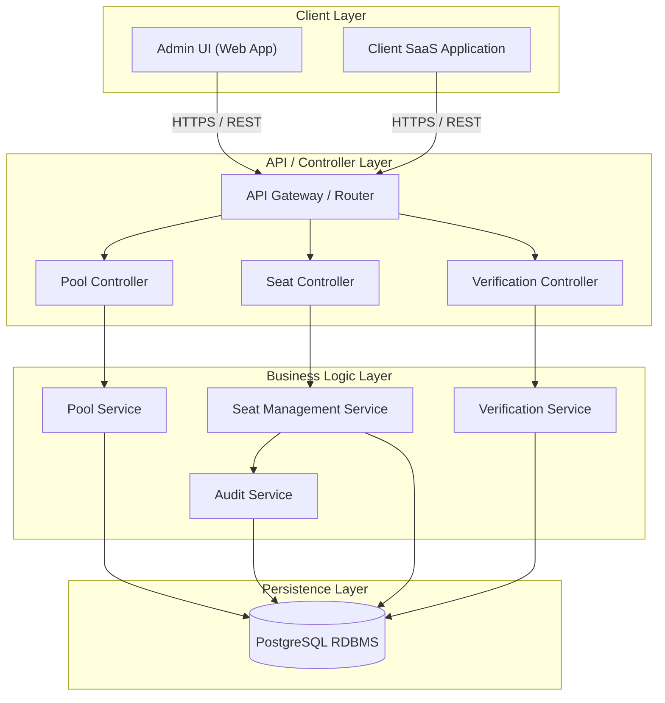
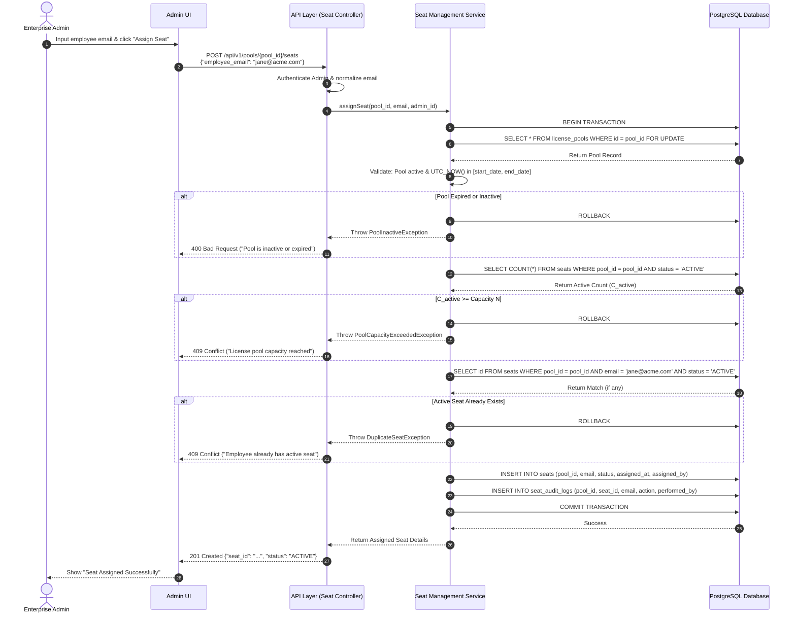
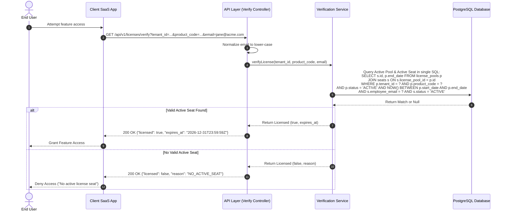

# Phase 4: Architecture - B2B License Management System (LMS)

This phase presents the high-level system architecture, explaining each architectural component before providing visual Mermaid.js sequence and component diagrams.

---

## 1. Architectural Components Breakdown

### 1. Enterprise Admin UI
* **Role:** Single-Page Web Application (React/TypeScript).
* **Responsibility:** Provides self-service UI for Enterprise Administrators to view pool capacity, monitor allocated seats, assign seats to employee email addresses, and trigger seat revocations.
* **Protocols:** Communicates with the API Layer over HTTPS/REST via JSON.

### 2. Client SaaS Application (Verifier)
* **Role:** External Enterprise Application / Gatekeeper Service.
* **Responsibility:** Intercepts user requests or login events within the main SaaS platform and queries the LMS for license verification before permitting user access to protected features.

### 3. API Layer (API Gateway & REST Controllers)
* **Role:** Stateless Entrypoint and Request Router.
* **Responsibility:**
  * **AuthN & AuthZ:** Validates JWT access tokens and permissions (e.g. Enterprise Admin role vs. System Billing Admin role).
  * **Input Validation & Normalization:** Validates request bodies (e.g. valid RFC email syntax, non-negative capacity, ISO-8601 timestamps) and normalizes input data (e.g. lower-case email formatting).
  * **HTTP Protocol Mapping:** Translates domain exceptions into standard HTTP status codes (e.g., `409 Conflict`, `400 Bad Request`, `404 Not Found`).

### 4. Business Logic Layer (Services & Transaction Orchestrator)
* **Role:** Core Application Domain Processing.
* **Responsibility:**
  * Enforces core domain invariants (Capacity $N$, active date range checks, duplicate seat detection).
  * Manages transactional boundaries to guarantee that seat assignment/revocation and audit logging succeed or fail atomically.
  * Coordinates pessimistic or optimistic concurrency strategies during high-concurrency allocations.

### 5. Relational Database (RDBMS - PostgreSQL)
* **Role:** Primary Persistent Data Store.
* **Responsibility:**
  * Provides ACID transactional guarantees.
  * Stores `tenants`, `license_pools`, `seats`, and `seat_audit_logs`.
  * Enforces schema constraints (Foreign Keys, Unique Indexes on `(license_pool_id, employee_email, status)`).
  * Executes row-level locking (`SELECT ... FOR UPDATE`) during seat allocation to eliminate race conditions.

---

## 2. High-Level System Architecture Component Diagram

---

## 3. Sequence Diagrams for Core Request Flows

### Flow A: Seat Allocation Request Path

---

### Flow B: License Verification Request Path

---

## Key Concepts to Understand Before Proceeding

1. **Layered Architecture Separation:** Clear boundaries between Presentation/API Layer (HTTP concerns), Service Layer (transaction orchestration & business logic), and Data Layer (ACID persistence).
2. **Pessimistic Row Locking (`FOR UPDATE`):** Acquiring a lock on the `license_pools` row inside the transaction serializes seat allocation attempts for that pool, guaranteeing capacity $N$ is never breached during concurrent admin operations.
3. **Single Optimized Query for Verification:** License verification executes as an optimized single SQL read query without explicit write locks, achieving minimal read latency ($<10\text{ ms}$).
